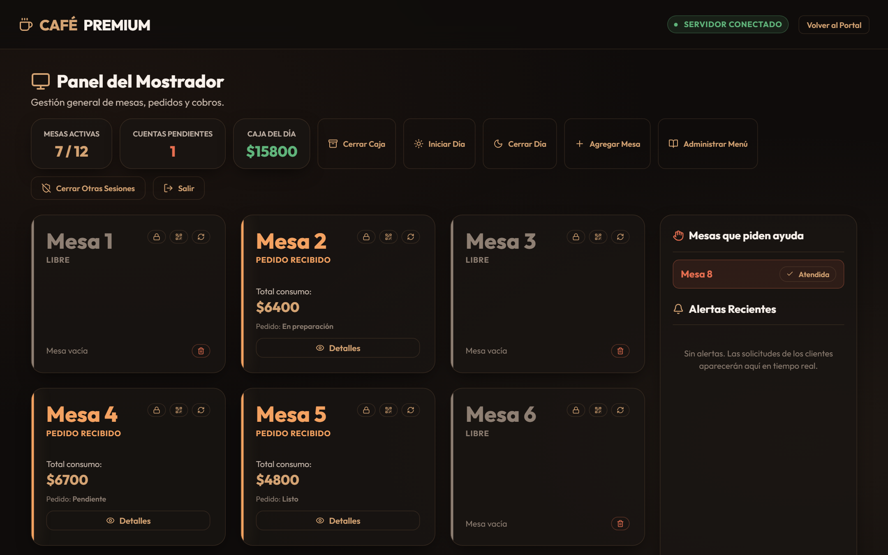
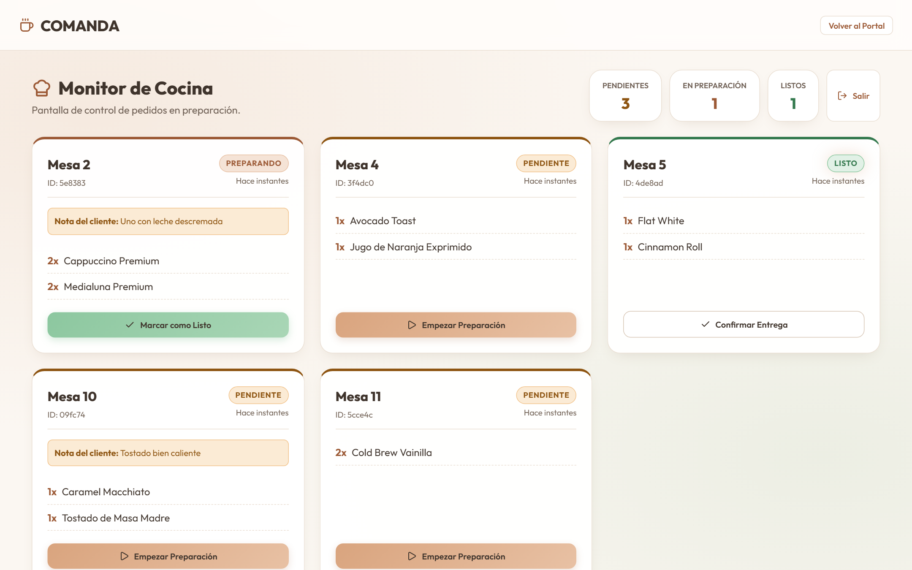
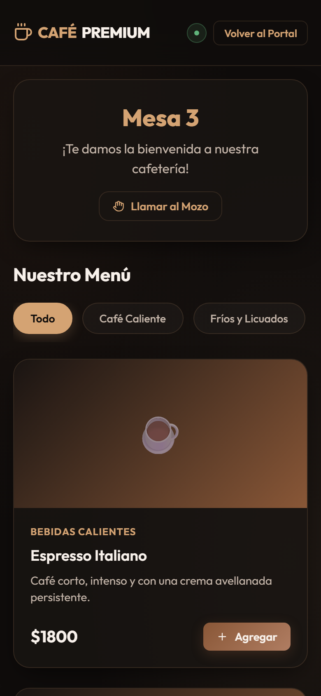
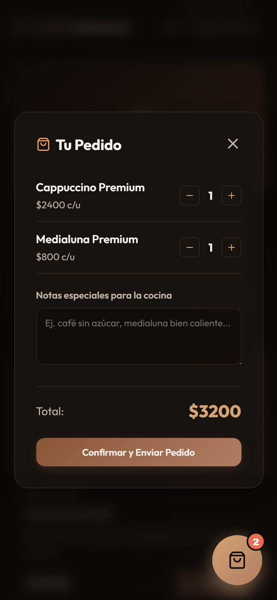

# Comanda

Sistema de pedidos en tiempo real para cafeterías: el cliente escanea el QR de su mesa y pide desde el celular, la cocina ve las comandas al instante y el mostrador gestiona mesas, menú, cobros y caja. Todo sincronizado por WebSockets.


[](https://github.com/peri294/Comanda/actions/workflows/ci.yml)
[](LICENSE)

**[Demo en vivo](https://comanda-rm70.onrender.com/)**: el portal tiene los links de las mesas y las contraseñas del personal. Corre en el plan gratuito de Render, así que si estuvo inactiva la primera carga tarda cerca de un minuto.

<p align="center">
  
</p>

| Cocina | Cliente: menú | Cliente: carrito |
| --- | --- | --- |
|  |  |  |

##  Qué resuelve

En una cafetería, el pedido pasa de boca en boca: mesa → mozo → cocina → caja. Comanda elimina esos saltos. Hay tres vistas sobre un mismo build, y cada una ve solo lo que le corresponde:

| Vista | Quién la usa | Qué hace |
| --- | --- | --- |
| **Cliente** (`?view=client`) | El cliente, desde el QR de su mesa | Entrar con el código de la visita, ver el menú con fotos y stock en vivo, armar el carrito con notas, enviar rondas de pedidos, seguir su estado, pedir la cuenta (efectivo/tarjeta) y llamar al mozo |
| **Cocina** (`?view=kitchen`) | La cocina, en una tablet | Tablero de comandas: pendiente → en preparación → listo, con aviso sonoro |
| **Mostrador** (`?view=counter`) | La caja / encargado | Estado de todas las mesas con su código de visita, cobros, edición y cancelación de pedidos, llamados al mozo, menú (categorías, productos, fotos y stock), alta/baja de mesas, QR imprimibles, inicio y cierre del día, cierre de caja, reportes de ventas, nombre y logo del local, copia de seguridad |

##  Características

- **Tiempo real con salas por rol y por mesa:** cada conexión entra a su sala de Socket.io (cocina, mostrador o una mesa puntual) y solo recibe sus eventos.
- **Pedidos confirmados por acknowledgement:** el carrito se vacía recién cuando el server confirma el pedido. Si el celular pierde la señal, el pedido se reenvía al reconectar y llega una sola vez.
- **Cortes de conexión a la vista:** sin conexión, el cliente ve que tiene que pedir ayuda al mozo, y las pantallas del personal se pausan (nada que se toque se pierde en silencio) y se rehidratan solas al volver.
- **Persistencia write-through en SQLite:** el estado de trabajo vive en memoria y cada cambio se escribe en disco de forma sincrónica (WAL, prepared statements, migraciones de esquema). Mesas, pedidos y caja sobreviven a un reinicio del server.
- **Menú administrable:** categorías propias, productos con foto, precios y stock ("Agotado") se editan desde el Mostrador y los clientes ven el cambio sin recargar. Las fotos se achican en el navegador y se guardan en la misma base.
- **Reportes de ventas:** total, ticket promedio por mesa, ventas por día, productos más vendidos y cierres de caja de cualquier período, exportables a CSV.
- **Listo para un local real:** nombre y logo configurables, pantalla de inicio solo para el personal en producción, copia de seguridad descargable y [guía de instalación](docs/INSTALACION.md).
- **Ciclo del día:** las mesas arrancan bloqueadas; "Iniciar Día" las habilita y "Cerrar Día" las bloquea, respetando las que todavía tienen clientes (se bloquean al cobrarlas).
- **Audio sintetizado con Web Audio API** para las alertas de cocina y mostrador, sin archivos externos.
- **UI glassmorphism con modo oscuro**, pensada para celular (cliente) y tablet (cocina/mostrador).

##  Seguridad

El sistema está expuesto a cualquiera que tenga el link de una mesa, así que el server no confía en el navegador:

- **Token secreto por mesa en el QR:** sin el token no se entra a la sala de la mesa. Los pedidos, la cuenta y los llamados usan la mesa atada a la conexión, nunca un `tableId` enviado por el cliente. El Mostrador puede regenerar el QR.
- **Código de visita:** el QR impreso es fijo, así que además hace falta un código de 4 dígitos que da el personal y cambia al cobrar la mesa. Quien se guardó el link no puede ver ni pedir a nombre del grupo siguiente. Los intentos se frenan por IP y por mesa, para no bloquear a todos los clientes que comparten el WiFi del local.
- **Precios y nombres resueltos en el server:** el cliente manda solo IDs de producto y cantidades. Se validan los payloads, las transiciones de estado de los pedidos y el método de pago.
- **Login de personal por rol:** contraseñas comparadas en tiempo constante (`crypto.timingSafeEqual`), sesiones revocables ("Salir" o "Cerrar Otras Sesiones" ante una tablet perdida) y bloqueo de 15 minutos tras 5 intentos fallidos desde la misma IP (las IPv6, por bloque /64), más un tope por rol contra ataques repartidos. Cocina solo recibe sus pedidos: la caja, los reportes, las fotos y la copia de seguridad son del mostrador.
- **Imágenes validadas por contenido:** el server verifica los primeros bytes de cada formato, no el tipo que declara el navegador.
- **Seguro por defecto:** sin `DEV_MODE=1` el server no expone endpoints de test, no acepta contraseñas por defecto ni CORS abierto, y no arranca si faltan las contraseñas, si tienen menos de 12 caracteres o si son iguales para los dos roles. Aun en desarrollo, los endpoints de test solo responden a la misma máquina.
- **Topes y headers:** cantidades, líneas y frecuencia de pedidos por mesa, tamaño de los mensajes del socket, textos y precios del menú. CSP, HSTS, `nosniff` y `Referrer-Policy: no-referrer` en todas las respuestas, y errores sin stack.
- **Al cobrar una mesa** el server desconecta sus celulares, para que el próximo grupo no vea los pedidos del anterior.

##  Arquitectura

```
  Cliente (QR)        Cocina          Mostrador
  React · celular    React · tablet   React · tablet
        \                |                /
         \     WebSocket (Socket.io)     /
          \       + REST (Express)      /
           +----------------------------+
           |        Node.js server      |
           |  server.js  → transporte   |
           |  domain.js  → reglas       |
           |  auth.js    → sesiones     |
           |  db.js      → persistencia |
           +-------------+--------------+
                         |
                  SQLite (node:sqlite)
```

El backend separa capas: `domain.js` contiene las reglas de negocio como funciones puras, sin sockets ni base de datos, y por eso se prueba con unit tests. `server.js` solo recibe el evento, llama al dominio, persiste y emite.

Las decisiones de diseño (y las alternativas descartadas) están documentadas en [`proyecto_memoria.md`](proyecto_memoria.md).

##  Stack

| Capa | Tecnologías |
| --- | --- |
| Frontend | React 19, Vite, Socket.io Client, CSS propio (sin framework), Lucide Icons, qrcode.react |
| Backend | Node.js 22 (ES Modules), Express 4, Socket.io 4 |
| Persistencia | SQLite embebido con el módulo nativo `node:sqlite` (sin dependencias nativas) |
| Testing | `node:test` (unit tests), Playwright (E2E) |
| Calidad | ESLint (reglas de React Hooks) |
| Despliegue | Un único servicio Node que sirve la API, los WebSockets y el build del frontend |

##  Estructura

```
backend/
  server.js       Express + Socket.io: endpoints, eventos y salas
  domain.js       Reglas de negocio (mesas, pedidos, validaciones)
  auth.js         Sesiones de personal y freno de intentos de login
  db.js           Esquema SQLite, migraciones y queries
  *.test.js       Unit tests
frontend/src/
  components/     ClientView, KitchenView, CounterView y sus modales (menú, reportes,
                  configuración, QR), StaffLogin
  hooks/          useSocketRoom, useStaffAuth, useCategories
  utils/          Formato de precios, imágenes (achicado y subida), sonidos
tests/            Specs E2E de Playwright
docs/             Guía de instalación y capturas
```

##  Correr en local

**Requisito:** [Node.js](https://nodejs.org/) **22.13 o superior** (por `node:sqlite`).

```bash
# Backend (puerto 3001)
cd backend && npm install && npm run dev

# Frontend (puerto 5173), en otra terminal
cd frontend && npm install && npm run dev
```

1. Abrí `http://localhost:5173/`. El portal tiene links a la cocina, al mostrador y a cada mesa (ya con el código de la visita).
2. **Login de personal** (contraseñas de desarrollo): `cocina123` para cocina y `mostrador123` para mostrador.
3. En el Mostrador, tocá **"Iniciar Día"** para habilitar las mesas.
4. **Desde un celular en la misma red:** abrí la dirección "Network" que muestra Vite, con el link de la mesa (sale del botón de QR en el Mostrador). El frontend deduce solo la dirección del backend; si vive en otro host, usá `VITE_BACKEND_URL`. La primera vez, Windows puede pedir permiso de firewall para Node.

##  Tests

```bash
npm run test:unit        # 58 unit tests del dominio y las sesiones (node:test)
npx playwright test      # 37 tests E2E (requiere backend y frontend corriendo en dev)
```

Los E2E cubren los flujos completos (pedido → cocina → cobro → reportes), la reconexión con pedidos en vuelo, el ciclo del día, el menú con fotos y la seguridad del transporte (tokens y códigos de mesa, roles, validación de payloads). En cada push, [GitHub Actions](.github/workflows/ci.yml) corre los unit tests, el lint, el build y la suite E2E completa. Los E2E arrancan con `/api/test/reset`, que **borra la base**: para conservar tu estado local, levantá el backend con `DB_PATH` apuntando a otro archivo.

##  Despliegue

En producción todo corre como un solo servicio: el backend sirve el build del frontend en el mismo origen. Funciona en hostings con procesos Node persistentes y WebSockets (Render, Railway, Fly.io), no en funciones serverless.

```bash
npm run build   # instala dependencias y compila el frontend
npm start       # levanta el server (usa PORT si el hosting la define)
```

**Instalarlo en un local:** la [guía de instalación](docs/INSTALACION.md) cubre la nube (Render con disco persistente) o una PC del local, la configuración inicial, el día a día del personal y las copias de seguridad.

**Demo en Render:** el repo incluye un [`render.yaml`](render.yaml) que despliega la demo pública en el plan gratuito. En Render: *New → Blueprint* y elegir este repositorio. El plan gratuito borra la base en cada reinicio: sirve para la demo, no para un local.

| Variable | Uso |
| --- | --- |
| `KITCHEN_PASSWORD` / `COUNTER_PASSWORD` | Contraseñas del personal. Obligatorias salvo con `DEV_MODE=1` o `DEMO_MODE=1`. |
| `TRUST_PROXY` | Cantidad de proxies delante del server (normalmente `1`), para que el freno de login vea la IP real. |
| `DEMO_MODE=1` | Demo pública: el portal muestra las mesas y las contraseñas, y el estado vuelve a fábrica tras un rato sin uso. |
| `DEMO_IDLE_MINUTES` | Minutos sin actividad antes de reiniciar la demo (por defecto 30). |
| `DB_PATH` | Ruta del archivo SQLite (en un disco persistente). |
| `TZ` | Zona horaria del local (por ejemplo `America/Argentina/Buenos_Aires`): define los días de la caja y los reportes. |
| `CORS_ORIGIN` | Solo si el frontend se publica en otro dominio (junto con `VITE_BACKEND_URL` al compilarlo). |
| `DEV_MODE=1` | Solo desarrollo (lo setea `npm run dev`): endpoints de test, contraseñas por defecto y CORS abierto. **Nunca en un despliegue.** |

##  Autor

Desarrollado por [peri294](https://github.com/peri294). Distribuido bajo licencia [MIT](LICENSE).
